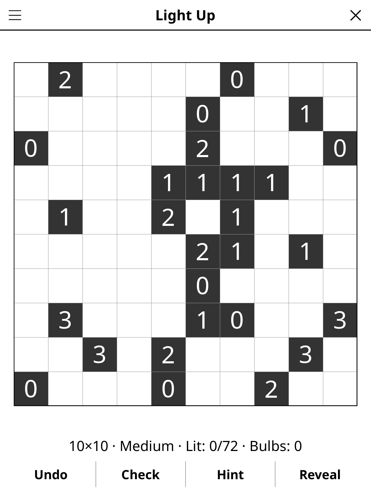

# lightup.koplugin

A Light Up (Akari) plugin for [KOReader](https://github.com/koreader/koreader).

## Screenshot

## Rules

Place light bulbs so every white cell is illuminated. Bulbs shine in four directions until blocked. Numbered black cells indicate exactly how many orthogonally adjacent bulbs are required. No two bulbs may illuminate each other.

## Concept

Light Up (Japanese: Akari, "light") is a binary-determination logic puzzle.
Place light bulbs in white cells of a grid so that:

1. Every white cell is illuminated (a bulb lights its entire row and column until
   blocked by a black cell).
2. No two bulbs illuminate each other.
3. Black cells with a digit must have exactly that many bulbs in adjacent cells.

## Features

- **Multiple grid sizes** — 7×7, 10×10, 14×14
- **Three difficulty levels** — Easy, Medium, Hard, graded by the reasoning each puzzle needs (see below)
- **Cell states** — empty, bulb, lit (yellow tint / hatched on greyscale), dot (confirmed empty)
- **Constraint highlighting** — tap a numbered black cell to highlight its adjacent cells
- **Illumination preview** — shows the lit area of a selected bulb
- **Check** — highlights conflicts (two bulbs seeing each other, wrong adjacency count)
- **Hint** — two taps: the first says which cell is about to give, the second acts on it. A cell that contradicts the solution is always reported before a fresh one is revealed
- **Reveal solution** — shows the full solution
- **Undo** — step back through your moves
- **Auto-save** — game state saved and restored on next launch

## Controls

| Action | How |
|--------|-----|
| Place / remove a bulb | Tap a white cell (in bulb mode) |
| Mark a cell as empty (dot) | Long-press or tap in dot mode |
| Toggle bulb / dot mode | Tap the **Mode** button |
| Undo last move | Tap **Undo** |
| Check progress | Tap **Check** |
| New game | Tap **New game** |
| Change grid size | Tap **Size** |
| Change difficulty | Tap **Difficulty** |
| Show rules | Tap **Rules** |

## Why e-ink friendly?

Illumination zones are static fill patterns (hatching) that refresh only when
bulbs are placed or removed. No animation is needed between moves.

## Difficulty

Every puzzle has exactly one solution, and can be solved by logic alone:
no level ever asks you to place a bulb "to see what happens".

- **Easy** — the basic rules are enough: count the bulbs around a number,
  and light a dark cell that only one cell can still light. Many numbers.
- **Medium** — one or two steps (three at 14×14) need a classic pattern:
  the cell diagonal to a number that can spare only one of its free
  neighbours holds no bulb, and neither does the corner cell that sees the
  last two cells able to light a dark cell. Fewer numbers.
- **Hard** — at least three such steps (four at 14×14), few numbers.

## License

GPL-3.0
